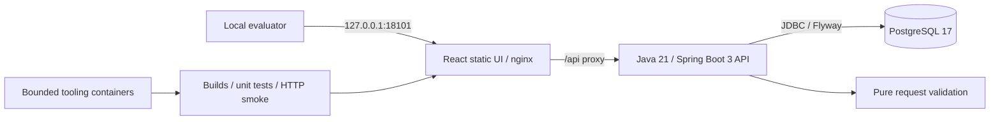

# Architecture

## Phase 1 deployment

The Compose project is always `firecrawl`. The web service is the only published
service. Port 18201 is reserved but unused. API and PostgreSQL share an internal
network with no external egress; nginx also attaches to a frontend network.
The database has an isolated project-named volume. No Redis, Kafka, workers,
browser processes, or telemetry collectors run at this stage.

The API does not contain an HTTP-fetch or job-execution implementation.

## Repository boundaries

| Path                   | Responsibility                                         |
| ---------------------- | ------------------------------------------------------ |
| `apps/web`             | React/TypeScript UI and component tests                 |
| `services/api`         | Spring Boot API, validation, health, migration, tests   |
| `services/worker`      | Documented reservation for Phase 3; no runnable service |
| `packages/contracts`   | OpenAPI for implemented Phase 1 routes                 |
| `infra/docker`         | Compose, nginx, bounded local/container tooling         |
| `tests/e2e`            | Real stack HTTP smoke tests using synthetic inputs     |
| `benchmarks`           | Future benchmark boundary; no fabricated measurements   |
| `scripts`              | Windows-compatible local setup and verification        |
| `docs`                | Requirements, safety, decisions, plan, execution proof  |

## Interfaces

nginx removes the `/api` prefix before proxying to the API:

| Backend route                          | Behavior                                               |
| -------------------------------------- | ------------------------------------------------------ |
| `GET /actuator/health/liveness`         | Process liveness, independent of database availability  |
| `GET /actuator/health/readiness`        | Requires readiness state, PostgreSQL, and schema V1     |
| `POST /crawl-jobs/validate`             | Validates a candidate request; no persistence or fetch  |

Actuator exposes health only, with no sensitive detail in public responses.
The future playbook routes `GET /crawl-jobs`, `POST /crawl-jobs`, and
`GET /crawl-jobs/{id}` are intentionally not implemented and must not return
success-shaped placeholder data.

## Persistence

Flyway V1 creates `platform_metadata` with a schema-version marker. A dedicated
health indicator verifies that marker, so readiness proves more than a live TCP
connection. Flyway validates migration checksums on startup.

The domain tables `crawl_jobs`, `urls`, `fetch_attempts`, `extraction_results`, and
`domain_policies` belong to Phase 2/3 and are not created here. No queue or
asynchronous events are justified yet.

V1 is additive. Automatic destructive rollback/clean is disabled. Reversing it
would require deleting a table and must not be attempted without explicit
approval. Future migrations must document compatibility and rollback boundaries.

## Configuration and observability

Connection configuration, JVM limits, logging format, and Compose settings are
environment-driven. A generated local database credential is passed as a
file-backed Docker secret, never committed or printed.

Spring Boot structured JSON console logging and Micrometer's OpenTelemetry
bridge form the instrumentation foundation. There is no remote exporter or
collector. Full tracing, dashboards, retries, and reliability engineering remain
Phase 5 work.

## Resource budget

Runtime targets: API 512 MiB/0.5 CPU, PostgreSQL 256 MiB/0.25 CPU, nginx
64 MiB/0.25 CPU (832 MiB and 1 CPU total). Tooling runs sequentially, with at most
1 GiB/1 CPU for dependency installation, compilation, and tests. Image builds
copy already-built artifacts rather than performing unbounded BuildKit
compilation. Images may require shared Docker download/extraction overhead; no
global Docker configuration is changed.
